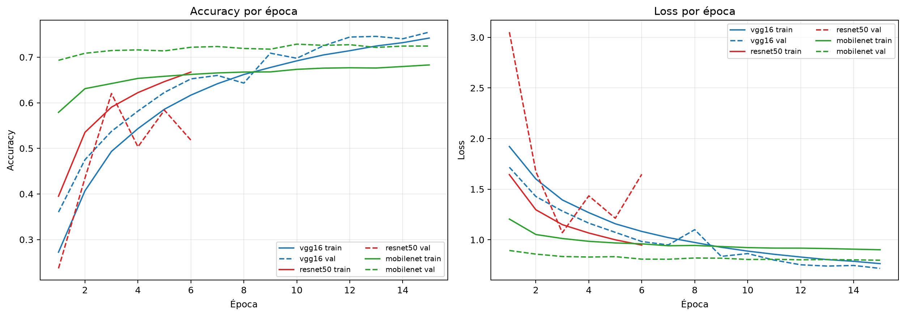
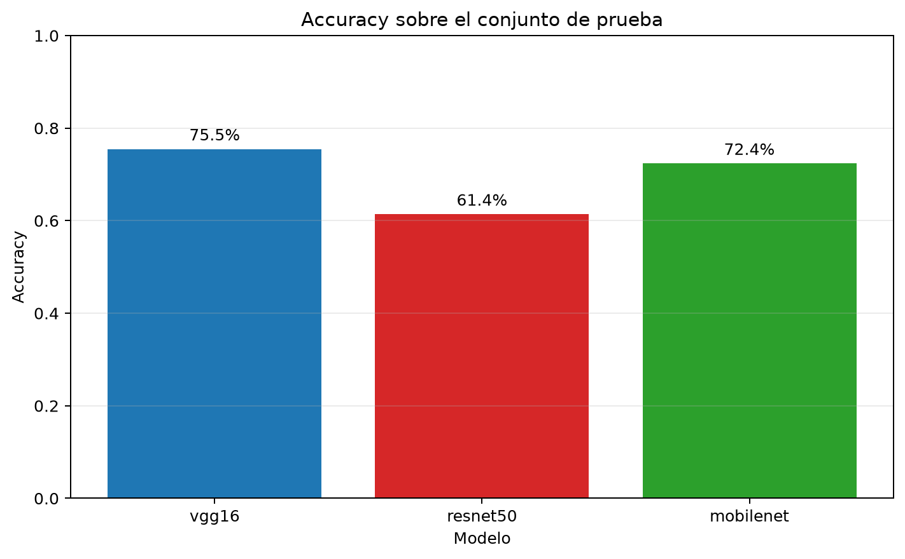

# Evaluación comparativa de arquitecturas convolucionales

Proyecto académico de la universidad **Hybridge** para la asignatura de Sistemas de Aprendizaje Profundo. El proyecto utiliza CIFAR-10 para construir, entrenar y comparar arquitecturas convolucionales mediante un notebook de Jupyter.

## Objetivos

- Diseñar e implementar dos arquitecturas CNN propias.
- Utilizar una arquitectura clásica mediante transfer learning.
- Aplicar data augmentation y regularización.
- Mantener un flujo reproducible para comparar las arquitecturas.
- Persistir los modelos, historiales, configuraciones y resultados.
- Analizar experimentalmente el comportamiento de cada modelo.

## Contenido del proyecto

```text
Arquitecturas_cnn/
├── Arquitecturas_cnn.ipynb
├── requirements.txt
├── README.md
└── artefactos/
    ├── modelos/
    ├── historiales/
    ├── configuraciones/
    ├── graficas/
    └── comparaciones/
```

La carpeta `artefactos/` está destinada a los archivos generados durante los experimentos:

- `modelos/`: modelos Keras guardados en formato `.keras`.
- `historiales/`: métricas de entrenamiento y validación en formato `.csv`.
- `configuraciones/`: semillas, hiperparámetros y parámetros del experimento en formato `.json`.
- `graficas/`: imágenes PNG utilizadas para visualizar las curvas de entrenamiento y validación y los resultados de prueba.
- `comparaciones/`: métricas finales de prueba en formato `.csv` y `.json`.


## Flujo del notebook

1. Importar las dependencias y establecer la semilla global.
2. Activar las operaciones deterministas de TensorFlow.
3. Definir el data augmentation.
4. Construir las dos CNN didácticas:
   - CNN secuencial personalizada.
   - CNN residual personalizada.
5. Construir MobileNetV2 con transfer learning y sus pesos de ImageNet congelados.
6. Cargar CIFAR-10 y separar entrenamiento, validación y prueba.
7. Redimensionar las imágenes de `32x32` a `64x64`.
8. Convertir las etiquetas a representación one-hot.
9. Entrenar una arquitectura seleccionada mediante `ARQUITECTURA`.
10. Guardar el modelo, el historial y la configuración.
11. Cargar los modelos disponibles y evaluarlos con el conjunto de prueba.
12. Generar los archivos de comparación y las gráficas.

La celda de entrenamiento debe ejecutarse una vez para cada valor de `ARQUITECTURA`:

```python
ARQUITECTURA = "vgg16"
```

También se pueden utilizar `"resnet50"` y `"mobilenet"`. Los nombres `vgg16` y `resnet50` corresponden a las dos CNN didácticas personalizadas del notebook; no representan las arquitecturas oficiales de Keras.

## Preprocesamiento y normalización

Las imágenes originales de CIFAR-10 llegan como valores RGB enteros en el intervalo `[0, 255]`. El pipeline las convierte a `float32`, las redimensiona a `64x64` y aplica el escalado dentro de cada modelo:

- CNN secuencial y CNN residual: `Rescaling(1./255)`, intervalo `[0, 1]`.
- MobileNetV2: `Rescaling(1./127.5, offset=-1)`, intervalo `[-1, 1]`, que es el preprocesamiento esperado por la red base.

El augmentation se aplica únicamente al flujo de entrenamiento. En validación y prueba las capas aleatorias funcionan en modo de inferencia.

## Reproducibilidad y comparación

Se utiliza la semilla `42` para Python, NumPy y TensorFlow/Keras. La semilla se restablece antes de crear cada experimento para controlar la inicialización de los modelos. Además, TensorFlow solicita operaciones deterministas.

La comparación utiliza la misma partición estratificada, los mismos parámetros generales y el mismo conjunto de prueba para las tres arquitecturas. Las métricas principales son `test_loss`, `test_accuracy` y el número de parámetros.

La comparación directa corresponde a las dos CNN didácticas personalizadas (`vgg16` y `resnet50`), que se entrenan desde cero bajo el mismo protocolo. `mobilenet` se incluye como una referencia adicional de *transfer learning*: su base MobileNetV2 utiliza pesos preentrenados de ImageNet, permanece congelada y se agrega una cabeza de clasificación para CIFAR-10. Por esta diferencia, sus resultados no constituyen una comparación estrictamente equivalente ni permiten atribuir una mejora únicamente a la arquitectura.

Al interpretar los resultados se deben distinguir los parámetros totales de los parámetros entrenables y no entrenables, además del preentrenamiento, el tiempo de entrenamiento y las métricas de prueba. Una mayor exactitud de MobileNetV2 puede reflejar el conocimiento transferido desde ImageNet y no necesariamente una superioridad arquitectónica frente a las CNN personalizadas.

## Instalación

Con el entorno virtual activado, instalar las dependencias con:

```powershell
pip install -r requirements.txt
```

Después, abrir `Arquitecturas_cnn.ipynb` en Jupyter o Visual Studio Code y ejecutar las celdas en orden o ver los resultados o pipelines de los modelos CCN.


## Conclusiones

Los modelos vgg16 y resnet son CNN didácticas personalizadas entrenadas desde cero con el mismo protocolo, mobilenetv2 es un modelo de referencia con transfer-learning.

El modelo vgg16 es el que obtuvo la mejor puntuación en la metrica accuracy en los datos de validación, el segundo es mobilenet y el tercero resnet50. El modelo vgg16 no tiene una diferencia significativa para indicar sobre-ajuste sobre su mejor resultado (en el intervalo de epocas ejecutado) en la metrica accuracy sobre los datos de entrenamiento y validación, sin embargo el modelo resnet50 muestra este comportamiento entre los datos de entrenamiento y validación, indicando sobre-ajuste. Tambien se encuentra en la metrica de perdida (Loss). Una posible exploracion para el modelo ResNet50 es configurar un intervalo de 0.4 - 0.5 en las capas Dropout, esta medida con el objetivo de aumentar la generalización del modelo. Tambien es posible aumentar la regularización. 

En consideración de un resultado de 61.4% en los datos de prueba del modelo ResNet, aun considerando, el sobre ajuste del modelo es real. A razón de que el conjunto de prediccion no representa a todas las clases en proporciones similares, por lo que se puede decir que el conjunto de prueba tiene una semejanza mayor al conjunto de entrenamiento que el conjunto de validación, lo anterior escrito como una posible hipotesis. 

ResNet fue el unico modelo en ser detenido en su entrenamiento, porque earlystopping detecto que no generalizaba mejor en tres epocas, ya que su perdida en sobre-ajuste aumento en este intervalo. Se puede observar en la grafica.

En la comparación de los ejemplos visuales de tres errores y tres aciertos por modelo se puede observar como el modelo vgg16 tiene una confianza muy por encima sobre las etiquetas correctas en comparación a los otros dos. 

Los resultados de mobilenet usando transferlearning son por que los pesos de Imagenet fueron diseñados para extraer caracteristicas de imagenes de mayor tamaño, las capas finales son relativamente pequeñas en comparacion al total incluyendo los pesos de la base congelada, los datos de cifar son pequeños favoreciendo una cnn pequeña entrenada directamente en el dominio de CIFAR. 

En resumén los tres modelos pueden cambiar su rendimiento segun los datos que aborden, los metodos e hiperparametros que se apliquen y las estrategias paralelas que se configuren (transferlearning). En este caso por el rendimiento inicial me decantaria por el modelo vgg16, sin embargo considerando que el modelo didactico no es el resultado del modelo VGG16 de keras, , el que podria tener resultados similares o no. Los modelos didacticos en este notebook funcionaron como aprendizaje de las capas que componen e diferencian a cada modelo.

Como trabajo futuro, se podría incorporar una matriz de confusión y métricas por clase para estudiar las confusiones específicas de cada arquitectura. Esto aportaría una comprensión más detallada del rendimiento y apoyar decisiones para optimización.

### Interpretación gráfica de los resultados

Las curvas siguientes muestran la evolución de los modelos durante el entrenamiento y la validación. Las líneas continuas representan el conjunto de entrenamiento y las líneas discontinuas el conjunto de validación.



- En **VGG16**, accuracy y loss muestran una evolución acompañada entre entrenamiento y validación en el intervalo ejecutado. Por ello, no se observa una diferencia clara que indique sobreajuste.
- En **ResNet50**, el accuracy de entrenamiento aumenta hasta 66.74%, mientras que el de validación desciende hasta 51.80%. Además, su `val_loss` alcanza 1.6469 en la época 5 frente a un loss de entrenamiento de 0.9473. Esta separación muestra el sobreajuste mencionado en la conclusión.
- ResNet50 finalizó después de 6 épocas, ya que `EarlyStopping` dejó de observar mejoras en `val_loss` durante tres épocas consecutivas.
- En **MobileNet**, accuracy y loss de validación son más cercanos a los de entrenamiento que en ResNet50, aunque su accuracy final es inferior al de VGG16.

La gráfica siguiente resume la exactitud obtenida por cada modelo sobre el conjunto de prueba:



VGG16 obtuvo el mejor resultado de prueba con 75.49%, seguido de MobileNet con 72.37% y ResNet50 con 61.40%. Este resultado concuerda con la comparación de validación y confirma que los tres modelos tienen comportamientos diferentes al observar datos nuevos.


